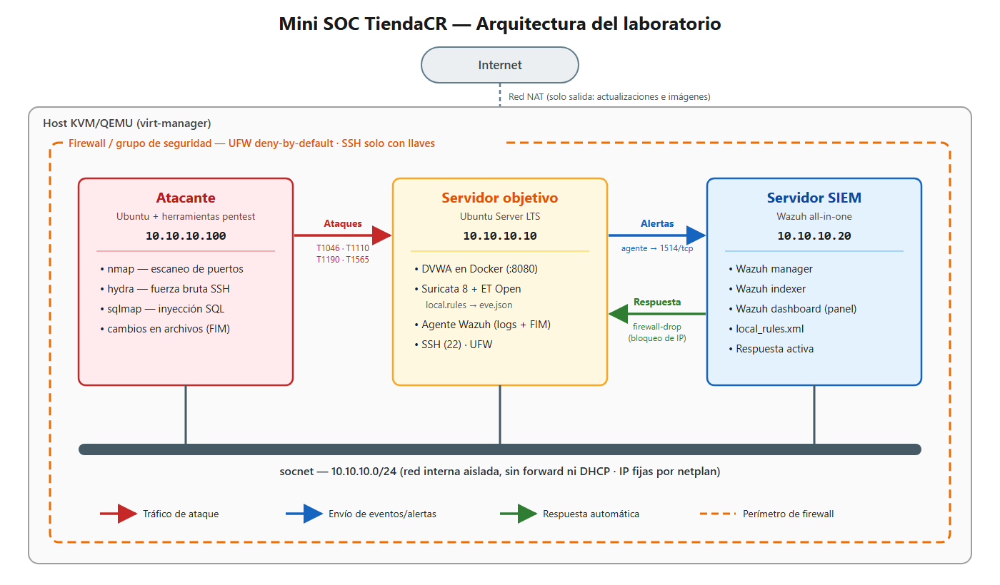

# Mini SOC en la nube — TiendaCR
**Curso ITI-922 · Integrantes: Steven Ramírez y Manuel Miranda**

## Arquitectura
Laboratorio local sobre KVM/QEMU (virt-manager) con red interna aislada `socnet` (10.10.10.0/24)
y red NAT para internet.



| Máquina | IP (socnet) | Rol |
|---|---|---|
| Servidor objetivo (Ubuntu) | 10.10.10.10 | DVWA + Suricata + agente Wazuh |
| Servidor SIEM (Wazuh) | 10.10.10.20 | Panel central y respuesta |
| Atacante (Ubuntu + pentest tools) | 10.10.10.100 | nmap, hydra, sqlmap |

## Estructura del repositorio
```
mini-soc-tiendacr/
├── README.md
├── arquitectura/        # diagrama de las 3 VMs + socnet
├── config/
│   ├── suricata/        # suricata.yaml (fragmentos), local.rules
│   ├── wazuh/           # ossec.conf (agente), local_rules.xml
│   └── netplan/         # 99-socnet.yaml de cada VM
├── docs/                # plan de respuesta a incidentes y referencias
├── scripts/
│   └── ataques/         # comandos nmap, hydra, sqlmap, etc.
└── evidencias/          # capturas (sin credenciales ni IP públicas)
```

## Requisitos
- Host con KVM/QEMU y virt-manager, ~24 GB RAM recomendado.
- Ubuntu Server LTS para las VMs; Docker para DVWA.

## Despliegue (resumen reproducible)
1. Crear la red aislada `socnet` (sin forward ni DHCP) y asignar IPs fijas por netplan.
2. Objetivo: Docker + DVWA (`vulnerables/web-dvwa`, puerto 8080); Suricata 8 con ET Open; agente Wazuh.
3. SIEM: instalador all-in-one de Wazuh (`wazuh-install.sh -a`).
4. Integrar Suricata → Wazuh (lectura de `eve.json` en el agente).
5. Control de acceso: UFW deny-by-default + SSH con llaves.

## Reglas propias
- `config/suricata/local.rules` — detección de SQLi (UNION SELECT).
- `config/wazuh/local_rules.xml` — regla personalizada de Wazuh.

## Ataques y detección
Ver la tabla del informe (nmap/T1046, hydra/T1110, sqlmap/T1190, FIM/T1565).

## Respuesta a incidentes
El plan basado en NIST SP 800-61 para el ataque de fuerza bruta SSH está en
[`docs/plan-respuesta-incidentes.md`](docs/plan-respuesta-incidentes.md).

## Referencias
Ver [`docs/referencias.md`](docs/referencias.md).

## Seguridad
Este repositorio no contiene credenciales. Las IP mostradas son de laboratorio (red privada).
